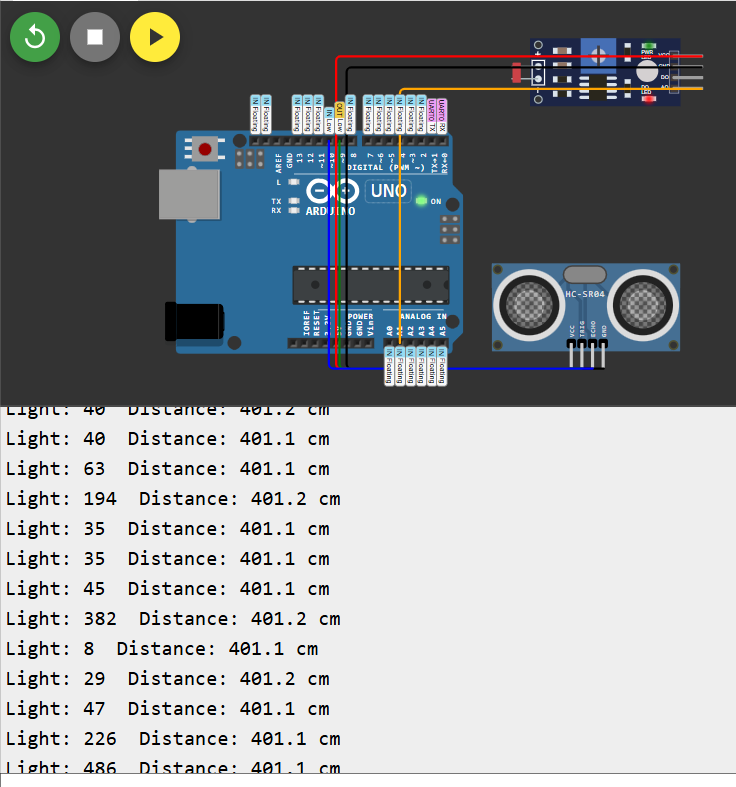
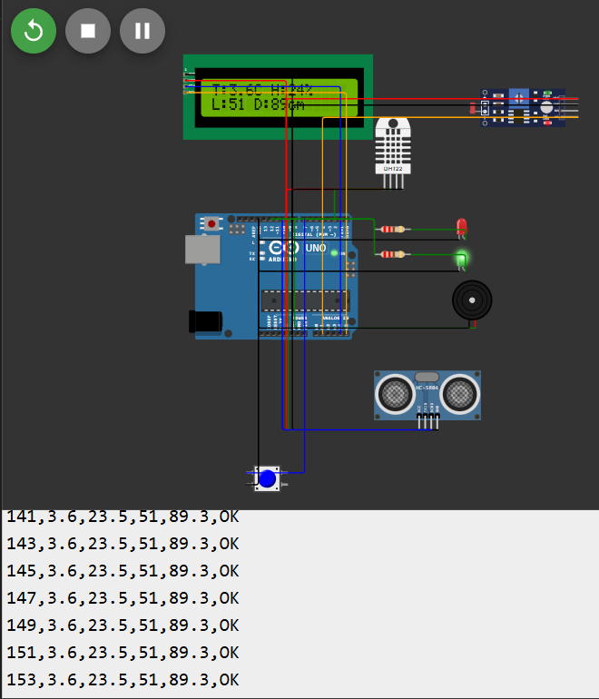
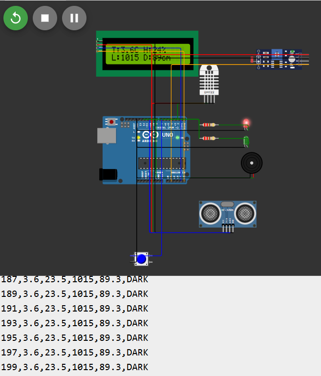

# Smart Home Environment Monitoring System

Sumerix Global - Embedded Systems & IoT Internship, Task 1

## Overview
Arduino Uno system that monitors temperature, humidity, light and distance. It shows live values on a 16x2 I2C LCD, logs data over Serial, and triggers a buzzer and LEDs when readings go abnormal.

## Features
- Temperature and humidity monitoring (DHT22)
- Light intensity detection (LDR)
- Distance measurement (HC-SR04)
- 16x2 I2C LCD with two pages (button switches page)
- Buzzer alarm and red/green LED status
- Serial data logging in CSV format
- Modular code (separate function per task)

## Components
Arduino Uno, DHT22, LDR module, HC-SR04, 16x2 I2C LCD, buzzer, red LED, green LED, 2 x 220 ohm resistors, push button, potentiometer, breadboard, jumper wires

## Pin Connections

| Component | Arduino Pin |
|---|---|
| DHT22 data | D2 |
| Push button | D7 |
| Buzzer | D8 |
| HC-SR04 Trig / Echo | D9 / D10 |
| Red LED (alarm) | D11 |
| Green LED (OK) | D12 |
| LDR module | A1 |
| LCD SDA / SCL | A4 / A5 |

## Alarm Rules

| Condition | Output |
|---|---|
| Temperature > 35 C | Buzzer + red LED |
| Humidity > 80 % | Buzzer + red LED |
| Distance < 10 cm | Buzzer + red LED |
| Dark environment | Red LED |
| All normal | Green LED |

## Progress

| Step | Task | Folder |
|---|---|---|
| 5 | Blink LED | `step5-blink` |
| 6-7 | Button + analog sensor | `step5-7-combined` |
| 8 | DHT22 | `step8-dht22` |
| 9 | LCD | `step9-lcd` |
| 10 | LDR + HC-SR04 | `step10-sensors` |
| 11 | Final project | `step11-final` |

## Circuit Diagrams






## Sample Serial Output
```
time_s,temp_C,humidity_pct,light,distance_cm,alarm
2,24.0,40.0,250,45.0,OK
4,36.5,40.0,250,45.0,TEMP
```

## Testing Results

| Test | Input | Result |
|---|---|---|
| Normal | Default values | Green LED, "All normal" |
| High temperature | Above 35 C | Buzzer + red LED |
| High humidity | Above 80 % | Buzzer + red LED |
| Close object | Below 10 cm | Buzzer + red LED |
| Darkness | Low light | Red LED |
| Button | Press | LCD page switches |

## How to Run
1. Install Arduino IDE
2. Install libraries: DHT sensor library, LiquidCrystal I2C
3. Open `Source-code/step11-final/step11-final.ino`
4. Select board Arduino Uno, upload, open Serial Monitor at 9600 baud
5. Or load `simulation/step11-final/diagram.json` in Wokwi

## Author
Pravin